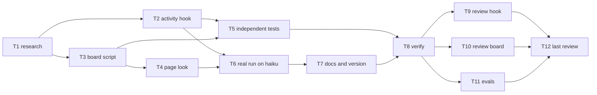
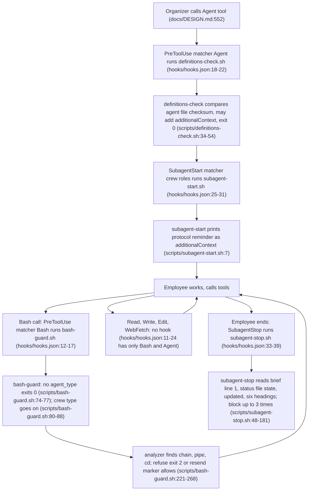
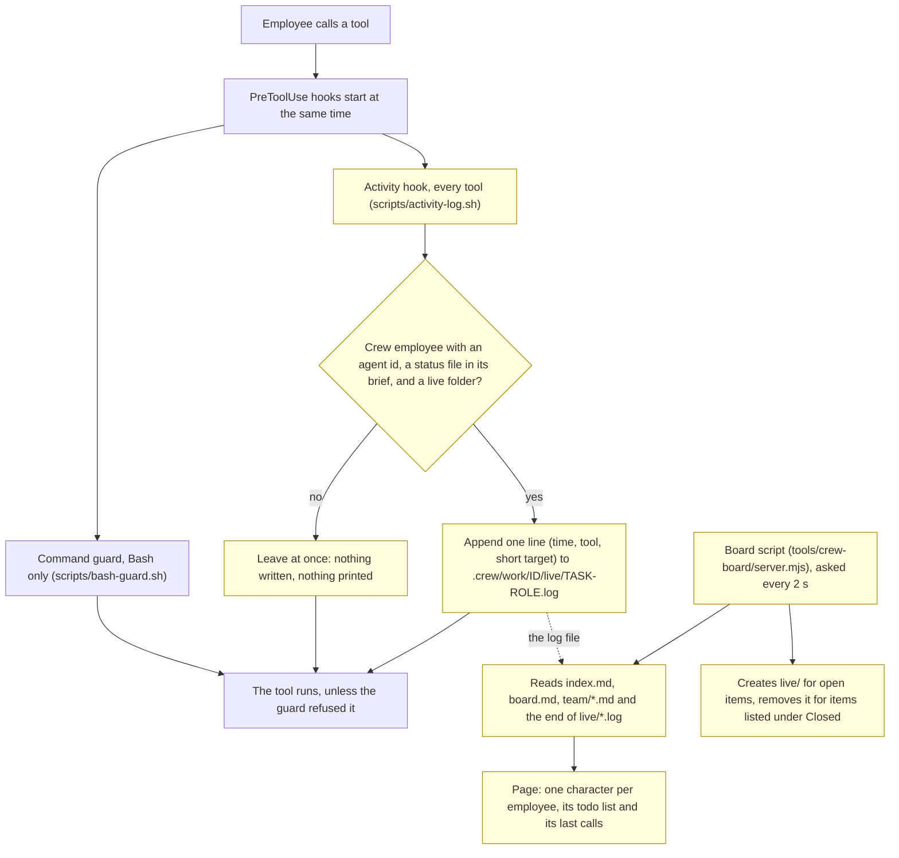

# Plan

| Task | Goal | File set | Acceptance check | Role | Tier | Depends on |
|---|---|---|---|---|---|---|
| T1 | Settle the hook input for every tool, the matcher, hook order, timing; draw the current flow | read only, scratch probe | report under `## Report` (done 2026-11-16) | researcher | standard | - |
| T2 | The activity hook: `activity-log.sh`, its entry in `hooks.json`, the 7-day prune of live logs in `session-start.sh`, and the tests its own check needs | `plugins/triple-a-crew/scripts/activity-log.sh`, `scripts/test-activity-log.sh`, `scripts/test-hooks.sh`, `scripts/session-start.sh`, `hooks/hooks.json` | `sh plugins/triple-a-crew/scripts/test-hooks.sh` ends with `all hook tests passed`; one line per employee call, none otherwise; measured time per call in the report | engineer | standard, effort high | T1 |
| T3 | The board script: server, parser, demo mode, creation and removal of `live/`, tests and fixtures | `tools/crew-board/server.mjs`, `parse.mjs`, `demo.mjs`, `test.mjs`, `fixtures/`, `README.md` | `node tools/crew-board/test.mjs` ends with `all crew-board tests passed`; `GET /api/state` matches the contract below on this repository and on the fixtures | engineer | standard | T1 |
| T4 | The page: characters, animations, todo lists, live ticker, call count | `tools/crew-board/index.html` | looked at in the browser with `--demo`, at desktop and phone width, light and dark, reduced motion; no script errors | organizer | fable (main session) | T3 |
| T5 | Independent tests for the hook and the parser, beyond T2's and T3's own | `plugins/triple-a-crew/scripts/test-activity-log.sh`, `tools/crew-board/test.mjs`, `tools/crew-board/fixtures/` | each regression in its brief is shown failing on a broken copy; both test commands pass | test-engineer | standard | T2, T3 |
| T6 | One real run on haiku with the hook loaded and `live/` present; watch the page show it | scratch folder only | the log has one line per tool call of the employee; the page shows the action within 3 s | organizer | - | T2, T4 |
| T7 | Docs and version: README, DESIGN, `formats.md`, plugin README, `plugin.json` 1.2.0, profile `verify` | `README.md`, `docs/DESIGN.md`, `plugins/triple-a-crew/README.md`, `plugins/triple-a-crew/skills/work/formats.md`, `plugins/triple-a-crew/.claude-plugin/plugin.json`, `.crew/profile.md` | every statement in its brief's list is in each file that states it (grep); `claude plugin validate .` passes | engineer | standard | T6 |
| T8 | Run the verify commands on the combined result | read only | each command's exit code and last line, verbatim | verifier | mechanical | T5, T7 |
| T9 | Review the hook: `activity-log.sh`, `hooks.json`, `session-start.sh`, their tests | read only | verdict and findings | reviewer | critical | T8 |
| T10 | Review the board: server, parser, page, their tests | read only | verdict and findings | reviewer | critical | T8 |
| T11 | Evals: `session-start-mentions-open-item` and `medium-fix-end-to-end`, one run each | `README.md` (cost table), `decisions.md` | both pass; costs recorded | organizer | - | T8 |
| T12 | Last review: the whole diff against `main`, every done-when line with evidence, the code against the final flow | read only | verdict, evidence per line, findings | reviewer | critical | T9, T10, T11 |

Models: standard is `sonnet`, mechanical is `haiku`, critical is `fable` (profile `models`).

## Contracts

These two are fixed here so T2, T3 and T4 can work apart.

**Log line** (written by T2, read by T3). One line per tool call, appended with one write:

```
<UTC time>	<tool name>	<target>
2026-11-16T14:05:12Z	Edit	src/db/orders.js
2026-11-16T14:05:19Z	Bash	node
2026-11-16T14:05:31Z	WebFetch	code.claude.com
```

- Fields are separated by one tab. The time comes from `date -u +%Y-%m-%dT%H:%M:%SZ`.
- Target by tool: `Read`, `Edit`, `Write`, `NotebookEdit`: the file path, relative to the project root when it
  is inside it. `Bash`: the program name only, after skipping leading `NAME=value` words; nothing when the
  first word has characters outside `A-Za-z0-9._/-`. `WebFetch`: the host of the URL. `Grep`, `Glob`: the
  pattern, cut to 60 characters. Every other tool: no target.
- Tabs, line breaks and control characters in a target become spaces; a target is cut to 120 characters and a
  line to 200 bytes. No file content, no full command, no query string, ever.
- File: `<root>/.crew/work/<id>/live/<task>-<role>.log`, where `<root>/.crew/work/<id>/team/<task>-<role>.md`
  is the status file the brief names. The hook writes only when that `live/` folder already exists.
- A line means a call was started. The command guard may still refuse it: the two hooks run at the same time.
- Tightened on 2026-11-16 after T5's tests: nothing is written when `live` is a symbolic link, or when the log
  path exists and is a link or not a regular file; a `WebFetch` URL with an `@` anywhere gets an empty target;
  a `Bash` program name longer than 40 characters gets an empty target.
- Tightened again on 2026-11-16 after review T9: the program-name limit is 30 characters; a `NAME=value`
  word whose value holds anything but letters, digits and `_ . / : @ % + , = -` ends the search with no
  target (the command is not parsed for quotes); nothing is written, and the prune deletes nothing, when
  `.crew`, `.crew/work` or the work item folder is a symbolic link; the status file's name must start with a
  letter or digit. After the recheck T9b: the 30 characters are counted on the whole word unless it starts
  with `/`, `./` or `../`.

**`GET /api/state`** (served by T3, drawn by T4):

```json
{
  "project": "claude-skill-folder",
  "now": "2026-11-16T14:05:33Z",
  "open": [
    {
      "id": "csv-export", "size": "L", "summary": "implement - T3 engineer running",
      "phase": "implement", "updated": "2026-10-16T14:05:00Z", "next": "wait for T2b, then staff T3",
      "tasks": [
        {
          "task": "T2",
          "attempts": [
            {
              "id": "T2b", "role": "engineer", "model": "sonnet", "effort": "high",
              "boardState": "in-progress",
              "status": {
                "state": "in-progress", "updated": "2026-10-16T14:05:00Z",
                "progress": [{ "done": true, "text": "Cursor query" }, { "done": false, "text": "Test with 200k rows" }],
                "questions": ""
              },
              "live": {
                "calls": 23,
                "last": [{ "at": "2026-11-16T14:05:12Z", "tool": "Edit", "target": "src/db/orders.js" }]
              }
            }
          ]
        }
      ]
    }
  ],
  "closed": [{ "id": "orders-limit", "size": "M", "note": "done 2026-10-12" }]
}
```

- `status` is `null` when the row has no status file or it cannot be read; `live` is `null` when there is no
  log. `effort` is `""` for an older board without that column. `last` holds at most the 8 newest lines.
- A progress line without a checkbox (`- text`) has `done: null`.
- The page asks for the state every 2 seconds.

## Flow



Current flow (drawn by the researcher):



Final flow (new and changed nodes are marked). It shows one tool call of an employee and the board beside it;
the start and the end of an employee stay as in the current flow:



Legend: yellow nodes are new or changed.

## Lessons that apply

- L14 (`claude plugin validate` may not read `hooks.json`): this plan adds a `hooks.json` entry. T2's tests
  check that `hooks.json` is valid JSON and names `activity-log.sh`, and T6 is a real run that shows the entry
  loads and fires.
- L15 (hook state in a shared temp folder, pruned after 7 days): the activity hook keeps no state file at all.
  It reads the brief on every call, and its only output is the log inside the work item. T2's brief says so.
- L17 (a researcher's figures were wrong): the organizer checked T1's key fact against the raw probe log
  (7 subagent inputs with an agent id, for Read, Write, Edit, Bash and WebFetch). T2's brief points at the raw
  log, and T6 checks the same facts in a real run.
- L19 (a brief's edge-case row contradicted its source): each brief's edge cases are copied from the rows of
  `brief.md`, not written again.
- L5, L7, L12 and L16 have mechanisms; this plan follows them: T1's probe goes into DESIGN's "Verified
  mechanics" (T7), T7's brief lists each changed statement with the files that state it, the log is
  append-only, and both test commands print a last line.

## Done-when coverage

| Done when | Met by |
|---|---|
| 1. The script serves a page that lists open and closed items | T3 |
| 2. Phase, next step and one character per board row; attempts grouped | T3 (data), T4 (page) |
| 3. Progress checklist, state, age of last update; a blocked one shows its question | T3 (data), T4 (page) |
| 4. Current action and call count on the page within 3 seconds | T2, T3, T4; shown in T6 |
| 5. One line per employee call; nothing for anyone else or without `live/` | T2, T5 |
| 6. Only time, tool and short target; secrets never reach the log | T2, T5 |
| 7. Never prints, never exits non-zero, never refuses; jq and no jq, `sh` and `dash` | T2, T5 |
| 8. `live/` removed for an item listed under Closed (logs and `.gitignore`; a folder with anything else stays); logs more than 7 days old deleted at session start | T3 (removal), T2 (prune) |
| 9. Crew text shown as text; only `GET`; foreign `Host` refused | T3, T4, T5 |
| 10. A demo with no model call | T3 (demo data), T4 (page) |
| 11. Animations stop under reduced motion | T4 |
| 12. Both test commands pass with their last lines; `claude plugin validate .` passes | T8 |
| 13. One real run on a cheap model; the two eval cases pass | T6, T11 |
| 14. Docs, `formats.md`, version 1.2.0, profile `verify` | T7 |
