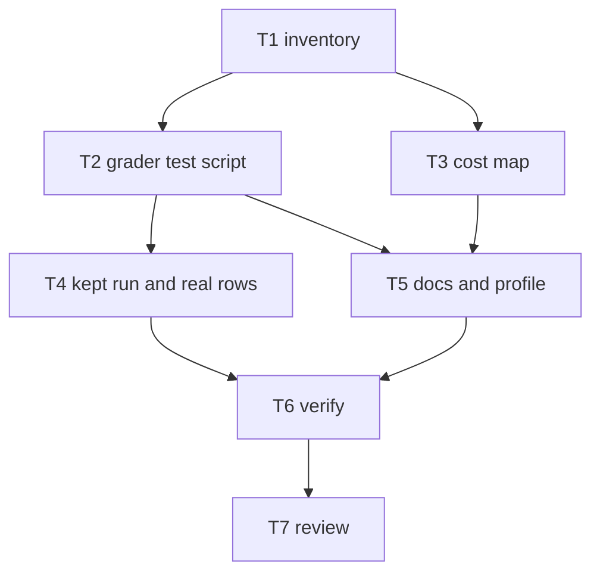

# Plan

From T1: 136 graders in 25 cases (55 `tool_used`, 39 `regex`, 21 `file_exists`, 21 `llm`). A `regex` grader is
a JavaScript regex over the trace, one JSON message per line; `tool_used` counts calls whose JSON input
matches. The eval command cannot grade a saved run again. No real trace rows exist in the repository, so one
kept run (`--keep-temp`) is needed to harvest some.

| Task | Goal | File set | Acceptance check | Role | Tier | Depends on |
|---|---|---|---|---|---|---|
| T1 | Inventory graders, semantics, incidents and costs | read only | five questions answered with evidence | researcher | standard | - |
| T2 | `scripts/test-graders.mjs`: check, self-test and harvest modes | scripts/test-graders.mjs, scripts/grader-rows/README.md (new) | exits 0 on the repository; the planted wrong grader fails | engineer | standard | T1 |
| T3 | Cost map in README "Evals" | README.md ("Evals" only) | all 25 cases and every plugin area appear; figures match their sources | engineer | standard | T1 |
| T4 | One kept eval run; harvest real rows; write the near-miss rows by hand | scripts/grader-rows/** | check mode passes on real rows; the run settles "joined or per line" | organizer | - | T2 |
| T5 | Docs for the grader test: README "Develop" and "Conventions for new skills"; profile `verify` and eval note | README.md (those two sections), .crew/profile.md | D.3, D.4, E.2 | organizer | - | T2, T3 |
| T6 | Verify | read only | 4/4, the new command included | verifier | mechanical | T5 |
| T7 | Review the whole diff against the done-when lines | read only | a verdict, and evidence per line | reviewer | critical | T6 |

T2 and T3 run in parallel: their file sets are disjoint.

## Flow

## Lessons that apply

- A regex grader tested only on hand-made rows (4 retros): T4 uses rows from a real trace, and each near miss
  is the real passing row with the wanted text removed.
