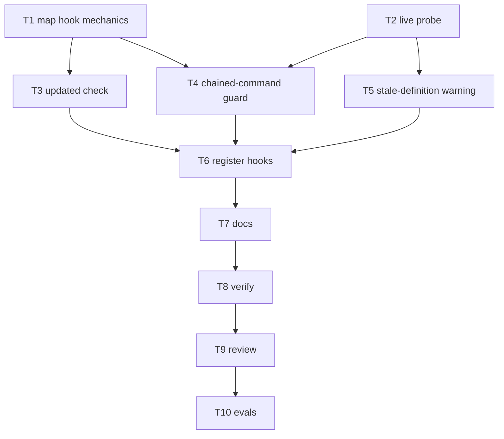
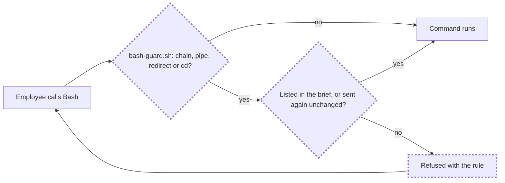

# Plan

From T1 (docs and code) and T2 (a live probe, five haiku runs on 2026-11-13):

- A PreToolUse input carries `agent_id` and `agent_type` only when a subagent makes the call.
- Exit code 2 with a message on stderr refuses a call; the subagent sees the message and carries on.
- The tool that starts a subagent is `Agent`. A PreToolUse hook on it can add context that the main session
  sees, and it fires before `SubagentStart`.
- A subagent's transcript, whose first line is the brief, is at `transcript_path` without `.jsonl`, plus
  `/subagents/agent-<agent_id>.jsonl`. It exists when the subagent's first tool call fires.
- No hook event fires on `/reload-plugins`.

| Task | Goal | File set | Acceptance check | Role | Tier | Depends on |
|---|---|---|---|---|---|---|
| T1 | Map the hook mechanics from the docs and the code | read only | five questions answered with evidence | researcher | standard | - |
| T2 | Live probe of hook payloads | a scratch folder outside the repository | a payload sample per question | engineer | standard | - |
| T3 | `updated` check in the stop hook (#32) | scripts/subagent-stop.sh, scripts/test-hooks.sh | the new cases pass under sh and dash | engineer | standard | T1 |
| T4 | Guard against chained commands (B) | scripts/bash-guard.sh, scripts/test-bash-guard.sh (both new) | its test file passes under sh and dash | engineer | standard, effort high | T1, T2 |
| T5 | Stale-definition warning (C) | scripts/session-start.sh, scripts/definitions-check.sh, scripts/test-definitions-check.sh (the last two new) | its test file passes; session-start output unchanged | engineer | standard | T2 |
| T6 | Register both hooks; run the two new test files from `test-hooks.sh` | hooks/hooks.json, scripts/test-hooks.sh | verify 3/3 | organizer | - | T3, T4, T5 |
| T7 | Docs: README "Hooks", the plugin README, DESIGN "Enforcement through hooks" and "Verified mechanics" | README.md, plugins/triple-a-crew/README.md, docs/DESIGN.md | each new behavior and each probe fact stated once, with its date | engineer | standard | T6 |
| T8 | Verify | read only | 3/3 | verifier | mechanical | T7 |
| T9 | Review the whole diff against the done-when lines | read only | a verdict, and evidence per line | reviewer | critical | T8 |
| T10 | Evals: the cases that load the hooks, one run each | read only | 1.00; cost reported | organizer | - | T9 |

T3, T4 and T5 run in parallel: their file sets are disjoint. All paths are under `plugins/triple-a-crew/`.

## Flow

Final flow of an employee's Bash call (new nodes marked):

## Done-when coverage

| Done when | Met by |
|---|---|
| #32.1 future-time case blocks, real-time case passes | T3 |
| #32.2 missing `updated` blocks, message gives the command | T3 |
| B.1 a chain or `cd` is refused with the rule | T4, T6 |
| B.2 a chained command the brief lists still runs | T4 |
| B.3 main session and non-crew agents never refused | T4 |
| B.4 the hook test covers chain, plain, quoted `&&` | T4, T6 |
| C.1 the organizer is told when it staffs an employee | T5, T6 |
| C.2 no message when nothing changed; tests cover both | T5 |
| D.1 tests pass under sh and dash; validate passes | T6, T8 |
| D.2 README and DESIGN describe the new behavior | T7 |
| D.3 hook-loading eval cases still 1.00 | T10 |
