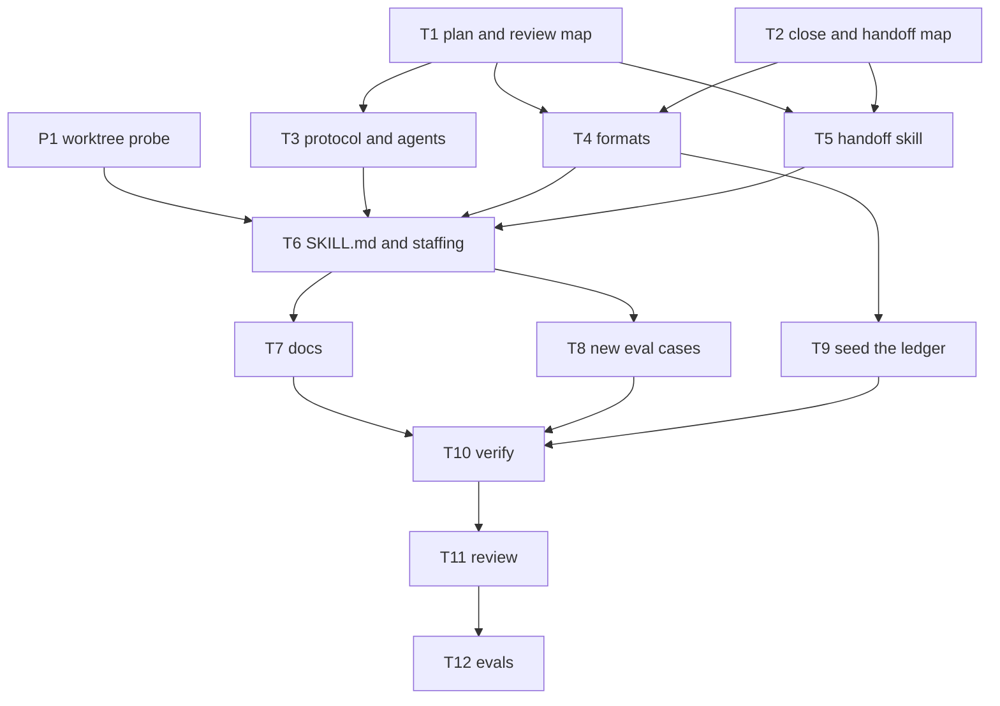

# Plan

From T1 and T2 (maps of where each rule is stated) and P1 (a live worktree probe):

- `SKILL.md` is at 160 lines, the working cap. Steps 5 to 8 repeat about six lines that `staffing.md` and
  `formats.md` already have; those move out, and no condition is dropped.
- An extra `## Report` section in a status file does not disturb the stop hook.
- Resume reads `index.md` and `board.md` only, so a paused item's `handoff.md` is never read today.
- P1: an `isolation: "worktree"` employee starts from the remote's default branch in
  `.claude/worktrees/agent-<id>`, can take in a local branch with `git merge --ff-only`, can commit, and can
  run a verify command as listed. It cannot write its status file in the main checkout.

| Task | Goal | File set | Acceptance check | Role | Tier | Depends on |
|---|---|---|---|---|---|---|
| T1 | Map the plan, brief and review rules | read only | tables for #40, #37, #38; every eval case classified | researcher | standard | - |
| T2 | Map the close step, handoff and worktree rules | read only | tables for A, G, H, F; every eval case classified | researcher | standard | - |
| P1 | Probe a worktree-isolated employee | its own worktree | each step's real output | engineer | mechanical | - |
| T3 | #37, #38 and the agent parts of #40 | skills/work/protocol.md, skills/work/teams.md, agents/researcher.md, agents/reviewer.md | each rule sentence in its file | engineer | standard | T1 |
| T4 | Formats: plan flow, lessons ledger, PR text, handoff | skills/work/formats.md | six parts present; `.gitignore` block unchanged | engineer | standard | T1, T2 |
| T5 | Handoff skill points to the work item's handoff and to research reports | skills/handoff/SKILL.md | three texts present; commands unchanged | engineer | standard | T1, T2 |
| T6 | The organizer's steps: all seven changes, within the line cap | skills/work/SKILL.md, skills/work/staffing.md | every changed rule matches its reference file; no condition dropped; 160 lines at most | engineer | standard, effort high | T3, T4, T5, P1 |
| T7 | Docs: every copy of the changed rules | README.md, docs/DESIGN.md, plugins/triple-a-crew/README.md | each copy matches; F.1 recorded in "Verified mechanics" | engineer | standard | T6 |
| T8 | Three new eval cases: flow in a plan, no flow for docs, a ledger lesson named in a plan | plugins/triple-a-crew/evals/ (three new folders) | each has a prompt, a fixture and graders; the cases can fail on the old text | engineer | standard | T6 |
| T9 | Seed this repository's ledger from the 10 retros | .crew/lessons.md | every repeated lesson has one row with its items | organizer | - | T4 |
| T10 | Verify | read only | 3/3 | verifier | mechanical | T7, T8, T9 |
| T11 | Review, in two parts: the rule text against the brief; the whole diff against the done-when lines | read only | a verdict, and evidence per line | reviewer | critical | T10 |
| T12 | Evals: the three new cases and the five the changes touch, one run each | read only | 1.00; cost reported | organizer | - | T11 |

T3, T4 and T5 run in parallel: their file sets are disjoint. T6 waits for them, so `SKILL.md` can point at
text that exists. T7 and T8 run in parallel after T6. All plugin paths are under `plugins/triple-a-crew/`.

## Flow

## Lessons that apply

- A rule changed in one file stays old in another (3 retros): each engineer brief carries the rule's exact
  words, and T11 greps every file for the words each rule hinges on.
- A trim to fit the line cap dropped a condition (`review-24-fixes`): T6's acceptance check names every
  sentence that leaves `SKILL.md` and where it now lives.
- The reviewer runs out of turns (4 retros): T11 is two reviews, each with a tool-call budget.

## Done-when coverage

| Done when | Met by |
|---|---|
| #37.1, #37.2 report on disk; brief template | T3, T6 |
| #37.3 handoff lists report files | T5 |
| #38.1 to #38.3 reviewer budget | T3, T6 |
| #40.1 formats show the diagrams | T4 |
| #40.2, #40.3 step 5 rules; approval message | T6 |
| #40.4, #40.5 researcher and reviewer parts | T3 |
| #40.6, #40.7 two eval cases | T8, T12 |
| #40.8 verify passes | T10 |
| A.1 to A.3 ledger at close and at plan | T4, T6, T9 |
| A.4 formats and an eval case | T4, T8, T12 |
| F.1 probe recorded in DESIGN | P1, T7 |
| F.2 the worktree rule fixed or removed everywhere | T6, T7 |
| G.1 to G.3 ship step | T4, T6 |
| H.1, H.2 one handoff, read on resume | T4, T5, T6 |
| H.3 `writes-handoff-to-crew` still 1.00 | T12 |
| I.1 line cap, nothing dropped | T6, T11 |
| I.2 every copy agrees | T7, T11 |
| I.3 touched eval cases 1.00 | T12 |
