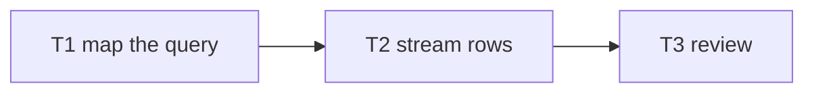
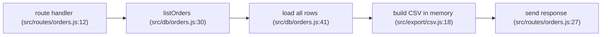
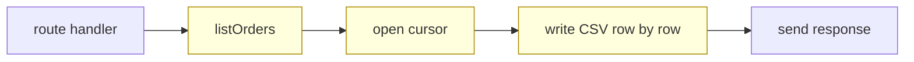

# Work item formats

Everything is under `<root>/.crew/`. Every file has exactly one writer: the organizer writes everything except
`team/`, where each employee writes only its own status file; the one exception is that the `handoff` skill
may write a work item's `handoff.md` when the item has none.

```
.crew/
  .gitignore
  lessons.md                                                     committed: the durable record
  work/
    index.md
    <id>/
      brief.md  plan.md  decisions.md  findings.md  retro.md  committed: the durable record
      board.md  handoff.md  team/<task>-<role>.md      ignored: working state
```

## .crew/.gitignore

```
work/index.md
work/*/board.md
work/*/team/
work/*/handoff.md
```

## index.md

```markdown
# Work items

## Open
- `csv-export` (L) - implement - T3 engineer running - updated 2026-10-16

## Closed
- `orders-limit` (M) - done 2026-10-12
```

## brief.md

```markdown
# <title>

**Size:** L · **Ticket:** SHOP-1062 (or none) · **Opened:** 2026-10-16

## What
## Why
## Done when
- [ ] Exporting 200k rows stays under 100 MB
- [ ] Old clients still parse the file

## Constraints
<from the profile and the user: stack rules, files not to touch, compatibility promises>

## Edge cases
| Case | In scope? | Covered by |
|---|---|---|
| 200k rows | yes | T2 streaming + T4 test |
| Field contains a quote | yes | T1 |
| Excel locale separators | no | findings.md |
```

## plan.md

````markdown
# Plan

| Task | Goal | File set | Acceptance check | Role | Tier | Depends on |
|---|---|---|---|---|---|---|
| T1 | Map how orders are queried | read only | report lists query path with path:line | researcher | standard | - |
| T2 | Stream rows from the query | src/db/orders.js | 200k rows under 100 MB (test) | engineer | standard | T1 |
| T3 | Review T2 | read only | verdict + findings | reviewer | critical | T2 |

## Flow



Current flow (drawn by the researcher):



Final flow (new and changed nodes are marked):



Legend: yellow nodes are new or changed.

## Lessons that apply

- L1 (date filters state their time zone): T2's acceptance check includes a UTC boundary case.

## Done-when coverage

| Done when | Met by |
|---|---|
| Exporting 200k rows stays under 100 MB | T2 |
| Old clients still parse the file | deferred to a follow-up item (decisions.md) |
````

A size M or L plan with three or more tasks has, under `## Flow`, a Mermaid `flowchart` of the tasks: one
edge per entry in the "Depends on" column and no others. When the change alters how something runs (a
request path, control flow, a state machine, a data pipeline), `## Flow` also shows the current flow and the
final flow, whatever the number of tasks. A researcher draws the current flow, with a `path:line` on every
node; at size M you may draw it yourself from code you have read, with the same `path:line` on every node.
You draw the final flow and mark each new or changed node. A change that alters no flow (docs, config, a
rename) has no current or final flow; it still has its task graph when it has three or more tasks. A plan
with no diagram has no `## Flow` section. About 12 nodes per diagram at most; split a larger flow. For size
L, copy the diagrams into the approval message exactly as they are in `plan.md`, the marks and the legend of
the final flow included; do not retell them in prose or redraw them.

`## Lessons that apply` names each open lesson in `lessons.md` that this plan could repeat, with the task or
brief line that guards against it. Leave the section out when none applies.

Size L only: the "Done-when coverage" table goes at the end of `plan.md`, with one row per done-when line of
`brief.md`. Size M has none.

## board.md

```markdown
# Board: <id>

**Phase:** implement · **Updated:** 2026-10-16T14:05:00Z

| Task | Role | Model | Effort | State | Status file |
|---|---|---|---|---|---|
| T1 | researcher | sonnet | medium | done | team/T1-researcher.md |
| T2 | engineer | sonnet | medium | missed twice: sent back, still failing | team/T2-engineer.md |
| T2b | engineer | sonnet | high | in-progress | team/T2b-engineer.md |
| T3 | reviewer | opus | high | todo | |

**Next:** wait for T2b, then staff T3.
```

One row per attempt: a re-staffed task keeps its id with the next letter (`T2b`, then `T2c`) and its own
status file, so the ladder's rung (staffing.md) can be read back after `/clear`. Model and effort are what
ran; when a user setting overrode the model, the State cell also names what was asked for.

## decisions.md

```markdown
# Decisions

- **2026-10-16 Stream with a cursor instead of paging with OFFSET.** OFFSET is O(n) per page at 200k rows.
  Rejected: building the CSV in memory (peak memory), a background job (out of scope).
```

## findings.md

```markdown
# Findings

- 2026-10-16 · `listOrders` ignores `limit` (src/routes/orders.js:12) · found by T1 researcher · filed as SHOP-1071
```

## retro.md

Written when a size M or L item closes as done (SKILL.md step 10). A paused item gets `handoff.md` instead,
and an abandoned one ("just do it") gets neither. Every point names its source file.

```markdown
# Retro: <id>

**Closed:** 2026-10-19

## What happened
- T1 missed its acceptance check twice; T1b (effort high) missed too, so T1c moved up to opus (board.md)
- The reviewer's must-fix: `since` compared local midnight with UTC (team/T3-reviewer.md)

## Lessons
| # | Lesson | Evidence | Repeat of | Goes to | Status |
|---|---|---|---|---|---|
| 1 | Date filters state their time zone | team/T3-reviewer.md | L1 | `.crew/profile.md` notes | proposed |
| 2 | The verifier brief chained commands that allow rules deny | team/T5-verifier.md | | <repository from plugin.json> | proposed |

## Proposed text
- **1** (`.crew/profile.md`, notes): "Date filters take and return UTC; the route's doc comment says so."
- **2** (issue draft): "Verifier brief chains commands that allow rules deny". The organizer wrote
  `a && b` into the verifier's brief; `Bash(node *)` did not match, so the command was denied. Suggested
  fix: the organizer writes one plain command per line in verifier briefs, and copies a profile command
  that contains `&&` as listed.
```

Status is `proposed` until the user answers, then `accepted` (applied or filed), `not filed` (accepted, but
the repository was missing or unreachable) or `declined`; a lesson that stays here says `kept`. A crew
feedback draft describes crew behavior only, never project code, paths or names. A lesson still `proposed` or
`not filed` in another item's retro is still open: name it in the report instead of proposing the same text
again; its ledger row still counts the new hit.

The "Repeat of" column holds a ledger id from `lessons.md` (`L1`), not an item name; it is empty for a new
lesson. The `#` column numbers the lessons of this retro only. When a repeat brings its ledger row to two
hits while `open`, "Goes to" names the proposed mechanism; if there is none, the ledger row says `none:` with
the reason and "Goes to" says `retro.md` only (none: see L3), naming the ledger id.

**Goes to.** Each lesson goes to one place, with its exact text under "Proposed text": a profile note or a
convention-file edit for this project; crew feedback about the organizer, an employee or a hook, as an issue
draft for the `repository` in `../../.claude-plugin/plugin.json` from this skill's folder (never the project's
tracker unless the user says so), describing crew behavior only, with no project code, paths or names; or
`retro.md` only, for a first-time lesson or a repeat whose ledger row says `none:`. If that repository is
missing or unreachable, keep the draft and say so. Apply none of the proposals until the user answers. Then
apply what they accept, and write an applied mechanism into the lesson's ledger row, and file an accepted
crew draft in that repository as written, not through `file-issue`.

## lessons.md

```markdown
# Lessons

| Id | Lesson | Hits | Items | Mechanism |
|---|---|---|---|---|
| L1 | Date filters state their time zone | 2 | orders-filter, csv-export | open |
| L2 | The verifier brief chained commands that allow rules deny | 1 | csv-export | brief: one plain command per line (protocol.md) |
| L3 | The export test depends on the machine's locale | 1 | csv-export | none: the CI image fixes the locale |
```

One row per lesson, across all work items of the project; you are its only writer. `Mechanism` is `open`, or
what now enforces the lesson and where (a hook, a brief line, an eval case, a profile note), or `none:` with
the reason. At close (SKILL.md step 10), each lesson of the retro raises `Hits` and adds the item on the
row it repeats, or gets a new row with the next id. A lesson that reaches two hits while `open` gets a
mechanism proposed in the retro, or `none:` with the reason; it is never left as a retro-only note. The plan
step reads the `open` rows. When the user accepts a proposed mechanism and it is applied, write it into the
row's `Mechanism`; until then the row stays `open`. A further hit while the proposed mechanism still waits
for the user raises `Hits`; the retro names the pending proposal and proposes nothing new. A project with
retros but no `lessons.md` gets one when its next item closes: seed it with one row for every lesson in those
retros, counting hits from their "Repeat of" entries.

## PR text

```markdown
<one or two sentences: what this pull request does and why>

## What changed
- <area or file>: <the change>

## Verification
- `<verify command>`: <result>
- Review: <verdict and rounds>

## Who did what
- <task>: <role> (<model>)

## Not done, on purpose
- <deferral, and where it is recorded>

Closes #12 · Refs #14 (open: <the criterion still open>)
```

At close you draft this text from the record: `brief.md`, `decisions.md`, the verify results and the board.
`Closes` and `Refs` follow protocol.md. The draft goes into your final report; opening the pull request is a
separate step the user asks for. Under Verification, add the project's own checks.

## handoff.md

```markdown
# Handoff: <id>

**Done:** T1, T2 (verified with `node --test`)
**Next:** staff T3 reviewer on the T2 diff
**Read first:** team/T1-researcher.md (its ## Report), team/T2-engineer.md
**Open questions:** <for the user>
```

A paused item has this one handoff. A session handoff written by the `handoff` skill points to it and does not
repeat it. Delete it after a resume once its open questions are answered or written to `decisions.md` and its
next step is on the board, so a later resume does not read an old one.
